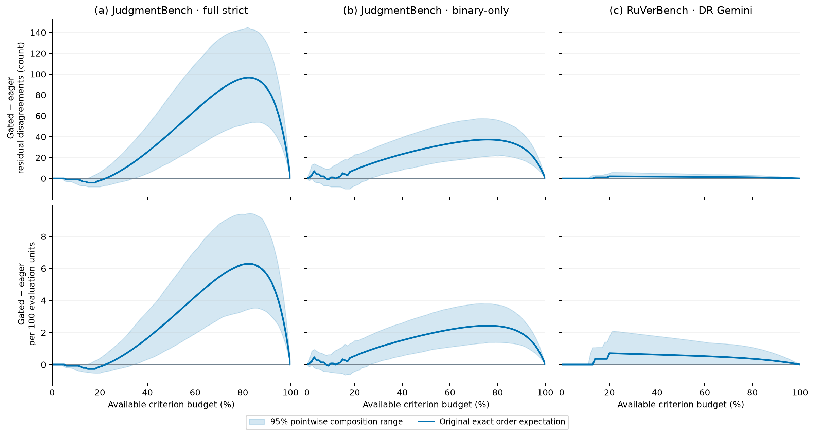

# Beyond Criterion Accuracy

### The Limits of Reference Checking in Conjunctive LLM Evaluation

[](https://github.com/Itsxuchen/RefEval/actions/workflows/reproduce.yml)

A reference check can estimate a judge's accuracy, certify an individual outcome, or repair an existing verdict. When every rubric criterion must pass, these gains can diverge. This repository studies constructed all-pass targets on **RuVerBench** and **JudgmentBench**, with compact analysis inputs, saved results and reproduction code. The full JudgmentBench target is a FAIL-dominated stress test; coding, research and binary-only targets provide contrasting error structures.

**Reproducibility release: [v0.3.0](https://github.com/Itsxuchen/RefEval/releases/tag/v0.3.0).** The tagged snapshot contains the matching manuscript, source archive, data and analyses. arXiv submission remains a separate step.

**External-validation update (2026-10-15):** WildIFEval failed the masked association and completeness checks. The planned four-judge frame retains four common task clusters; even a two-judge diagnostic retains only 40. Pilot and held-out analyses have not run. [Findings and reproduction](docs/WILDIFEVAL.md).

**Manuscript draft:** [PDF](artifacts/manuscript/paper.pdf) · [LaTeX](artifacts/manuscript/paper.tex) · [Methods and proofs](artifacts/manuscript/methods_appendix.tex) · [Build instructions](docs/REPRODUCIBILITY.md#manuscript-build-and-claim-checks) · [Portable TeX source](artifacts/manuscript/arxiv_source.zip)

## Main findings

1. **Correcting criterion errors can worsen task verdicts.** In full-target JudgmentBench with GPT-5.4 as the primary judge, checking all **4,316** criteria on which it disagrees with GPT-5.4-mini corrects **1,217** criterion errors. Eager updating nevertheless increases task disagreements from **244 to 245**: four verdicts are repaired, while five correct rejections become false passes. The checks remove mistaken reasons for rejection before reaching the criteria that actually fail.

2. **Waiting for certificates can delay substantial repair across different error regimes.** On the same queried labels, certificate-gated updating prevents new false passes but postpones repairs until the task is certified. Under disagreement-first continuation in full JudgmentBench, the exact expected gated-minus-eager difference is **+96.3 disagreements at an 84% budget** across 1,539 annotations. The break-even false-pass/false-fail cost ratio is **0.725 at 20%** and **9.1 at 84%**; gating has lower expected weighted loss above the corresponding ratio. At 50% and 84%, the full-JB difference is positive in all 399 task-composition resamples. At 20%, the two RuVerBench coding judges have net expected effects of **2.56–5.31 disagreements per 100 tasks**, despite a majority of reference passes and no JB penalty items. The direction persists in **396/399 Qwen** and **399/399 DeepSeek** task-composition resamples. Coding has no repeated-reference-panel check. On 206 matched outputs with fixed judge predictions, the 84% excess is **6.0 or 3.9 per 100 outputs**, depending on the reference panel. [Mechanisms](docs/METHODS.md) · [Sensitivity results](docs/ROBUSTNESS.md)

3. **Certification gains translate unevenly into repair.** At a 20% budget, the fixed 50/50 certification-plus-sampling allocation increases certification in every paired query order across all nine cells. Mean residual-disagreement changes versus random criterion sampling range from **−2.26 to +0.81** in the five RuVerBench cells and **−91.48 to −58.68** in the four JudgmentBench cells. The focal DR Gemini comparison gains certificates throughout task-composition resampling, while its repair effect changes direction. JudgmentBench's focal allocation gains persist under the separate reference and task-composition checks. [Result keys](docs/RESULTS.md)

4. **Criterion summaries leave task-level conclusions unresolved.** Holding criterion confusion counts fixed, alternative task-linked label configurations favor opposite update rules in **44 of 90 examined cell–policy–budget settings**. The appendix reports all 90 effect magnitudes; in 19 reversing conditions, both the original and strongest reverse effect are below one evaluation unit. These configurations also change task pass rates. A separate four-task construction preserves every task verdict and the criterion confusion counts yet reverses the expected update difference; exhaustive enumeration verifies all 792 five-label query sets. It is a logical example, not a pass-total-constrained empirical replay. A complementary disclosure experiment hides and restores task associations to measure the resulting feasible pass-rate ranges. Design-based sampling intervals and logical identification bounds answer different questions. [Information analysis](docs/METHODS.md#information-sufficiency-and-pairing)



Disagreement-first continuation, with pointwise task-composition ranges from 399 whole-base-task resamples. [Complete curves and interpretation](docs/ROBUSTNESS.md) · [Earlier four-policy view from the seven-policy study](artifacts/figures/conjunction_policy_study/policy_frontiers_early.png) · [All-cell update curves](artifacts/figures/conjunction_policy_study/verdict_update_budget_all_cells.pdf)

## Estimation, certification, and repair at the same budget

At a **20% criterion-query cap**, compare criterion simple random sampling (SRS), a fixed mix that spends up to half the cap on judge-first short circuit before sampling the remainder, and pure judge-first certification. All policies below use the same actual query count within each cell.

| Reference frame / allocation | Queries | Certified units | Residual verdict errors | Accuracy interval width (pp) |
|---|---:|---:|---:|---:|
| DR Gemini / criterion SRS | 323 | 131 | 8 | 5.51 |
| DR Gemini / fixed 50/50 mix | 323 | 169 | 9 | 7.62 |
| DR Gemini / pure certification | 323 | 275 | 1 | — |
| JB GPT-5.4 full / criterion SRS | 4,697 | 798 | 223 | 2.21 |
| JB GPT-5.4 full / fixed 50/50 mix | 4,697 | 1,035 | 133 | 2.95 |
| JB GPT-5.4 full / pure certification | 4,697 | 1,512 | 15 | — |

Entries after queries are per-column medians over 31 randomized priority orders, with release task order. Accuracy means criterion-level microagreement; intervals use conditional, pointwise 95% hypergeometric inference. A dash marks the absence of a probability-sampling accuracy interval. [Paired effects and source keys](docs/RESULTS.md) · [Inclusive endpoint repair](docs/REPRODUCIBILITY.md#numerical-endpoint-repair-020)

[Estimation controls](docs/ROBUSTNESS.md#budget-accounted-stratified-controls) also compare proportional and budget-charged pilot-Neyman sampling. The [nine-cell figure](artifacts/figures/conjunction_robustness_estimation.png) shows conservative interval width and exact design RMSE at the 20% cap; the [reference comparison](artifacts/figures/conjunction_robustness_reference.png) holds judge predictions fixed.

## Research questions

1. **Error propagation and updating:** For the same queried reference labels, when does certificate-gated updating prevent more errors than it delays repairs, and how do error configurations and query order shape that balance over the budget?
2. **Allocation of limited references:** How do sampling units and query allocations trade estimation precision against certification coverage and verdict repair, and when do certification gains translate into fewer residual disagreements?
3. **Evidence sufficiency:** Which task-level conclusions are determined by criterion summaries and queried reference labels, what additional task associations are needed, and how does identification differ from statistical estimation?

The three contributions measure matched-query update effects, connect certificate placement to repair and estimation costs, and establish which task-level conclusions criterion summaries leave unresolved. The [nearest-neighbor comparison](docs/METHODS.md#closest-comparisons-target-observation-update-and-guarantee) distinguishes this contribution from earlier screening, Boolean certification, selective updating, and prediction-assisted estimation.

## Scope

- Errors, repairs, and certificates are defined relative to released reference labels. JudgmentBench's individual human ratings have unresolved disagreement; fixed-judge reference replacement examines its consequences.
- Strict all-pass targets are constructed for this study. JudgmentBench includes positive binary conditions and zero-occurrence penalty conditions; RuVerBench uses its retained released criteria.
- Nine analysis cells share tasks within two data families. JudgmentBench's 1,539 annotations arise from 30 base tasks, and its full-target judge predicts only 31 PASS verdicts.
- Query-order variation, task-composition resampling, and reference replacement describe different sensitivities. Population confidence intervals come from the stated sampling designs; the fixed allocation split is a comparison condition.
- One query reveals one stored reference bit. Budgets measure label access, with expert time and auxiliary-judge costs outside this replay. The [external-validation protocol](context/conjunction_external_validation_protocol.md) retains the prospective design and records the failed masked preflight; outcome validation remains unexecuted.

## Reproduce

From the repository root, inside a Python environment:

```bash
python -m pip install -r requirements.lock.txt
python -m src.check_package
python -m pytest
python -m src.reproduce --mode smoke --output artifacts/smoke
```

For the complete original and extension analyses:

```bash
python -m src.reproduce --mode full --output artifacts/reproduced
python -m src.verify_release --results artifacts/reproduced
python -m src.reproduce_extensions --output artifacts/reproduced-extensions
python -m src.reproduce_extensions --output artifacts/reproduced-extensions --verify-only
```

Replay uses the included inputs and runs offline. Smoke mode checks bounded execution; full mode covers the declared analysis. Commands write to the specified output directories. [Reproduction scope, versioned validation records, and manuscript checks](docs/REPRODUCIBILITY.md)

## Documentation and citation

[Methods](docs/METHODS.md) · [Results](docs/RESULTS.md) · [Robustness](docs/ROBUSTNESS.md) · [Bibliography](docs/references.bib) · [Data provenance](docs/DATA_SOURCES.md) · [Policy protocol](context/conjunction_policy_protocol.md) · [Label-value protocol](context/conjunction_label_value_protocol.md)

Inputs contain the numerical records and identifiers needed for replay. Source task texts, full responses, free-text comments, and human-time fields remain with the upstream releases. Code uses the [software license](LICENSE); dataset-derived files follow their [upstream terms](THIRD_PARTY_NOTICES.md).

Use [CITATION.cff](CITATION.cff) for the software package and cite the upstream datasets for their records. The manuscript is a draft awaiting a paper identifier.

Codex and Claude assisted code development, analysis checks, and research writing. The human author retains responsibility for the scientific claims and final manuscript.
